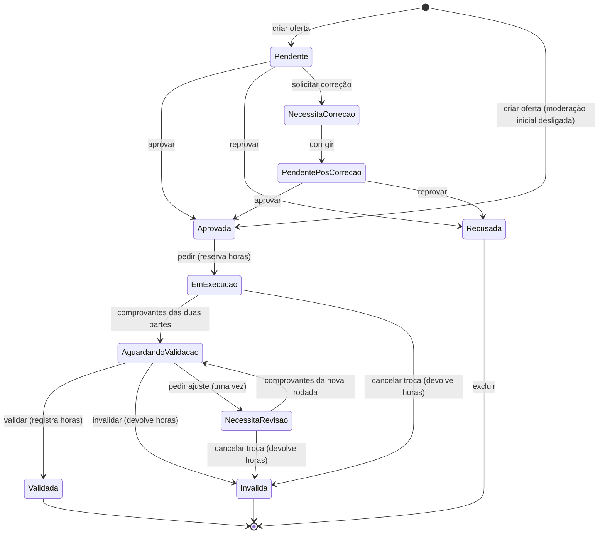

# Máquina de estados da atividade

A tabela abaixo está no código em `BancoTempo.Api/Services/TransicoesAtividade.cs` (`TransicoesAtividade.Tabela`). Nenhum controller muda `Status` diretamente: toda transição passa por esse serviço.

## Estados

| Valor | Nome no código | Como aparece para quem usa |
|---|---|---|
| 1 | Pendente | Oferta esperando a moderação inicial |
| 2 | Aprovada | Oferta aberta para pedidos |
| 3 | Recusada | Oferta não aceita pela moderação |
| 4 | NecessitaCorrecao | Oferta com pedido de ajuste da moderação |
| 5 | PendentePosCorrecao | Oferta corrigida, esperando a moderação de novo |
| 6 | EmExecucao | Troca combinada: horas de quem pediu reservadas |
| 7 | AguardandoValidacao | As duas partes enviaram comprovantes; em conferência |
| 8 | NecessitaRevisao | Conferência pediu ajuste nos comprovantes |
| 9 | Validada | Troca concluída: horas registradas para quem ofereceu |
| 10 | Invalida | Troca invalidada ou cancelada: horas devolvidas a quem pediu |

## Transições permitidas

| Ação | De | Para | Quem executa | Efeito nas horas | Evento gravado |
|---|---|---|---|---|---|
| Criar oferta | (nova) | 1, ou 2 se `ModeracaoInicial` for `false` | qualquer pessoa logada | nenhum | `oferta_criada` |
| Aprovar | 1, 5 | 2 | moderação, exceto na própria oferta | nenhum | `oferta_moderada` |
| Reprovar | 1, 5 | 3 | moderação, exceto na própria oferta | nenhum | `oferta_moderada` |
| Solicitar correção | 1 | 4 | moderação, exceto na própria oferta | nenhum | `oferta_moderada` |
| Corrigir | 4 | 5 | quem oferece | nenhum | `transicao_aplicada` |
| Pedir (rota `/comprar`) | 2 | 6 | outra pessoa logada (nunca quem oferece) | reserva o tempo das horas de quem pede | `pedido_feito` (delta negativo) |
| Comprovantes completos | 6, 8 | 7 | sistema, quando as duas partes enviam comprovante na rodada atual | nenhum | `transicao_aplicada` |
| Validar | 7 | 9 | moderação, exceto participantes | soma o tempo às horas de quem ofereceu | `horas_registradas` (delta positivo) |
| Invalidar | 7 | 10 | moderação, exceto participantes | devolve o tempo a quem pediu | `horas_devolvidas` (delta positivo) |
| Pedir ajuste nos comprovantes | 7 (só se `RevisoesComprovantes` = 0) | 8 | moderação, exceto participantes | nenhum; abre a rodada seguinte de comprovantes | `transicao_aplicada` |
| Cancelar troca | 6, 8 | 10 | moderação, exceto participantes | devolve o tempo a quem pediu | `horas_devolvidas` (delta positivo) |
| Excluir oferta | 3 | (removida) | quem oferece | nenhum | nenhum |

## Diagrama

## Como a concorrência é tratada

- Cada transição lê o status atual e aplica um `UPDATE ... WHERE "Id" = @id AND "Status" = @lido`, com `ExecuteUpdateAsync`. Se outra pessoa mudou a atividade no meio, o UPDATE afeta zero linhas, a transação é desfeita e a resposta é 409 `TRANSICAO_INVALIDA` (ou 409 `OFERTA_JA_PEDIDA` no pedido).
- O pedido exige também `"CompradorId" IS NULL` e `"OfertanteId" <> @pessoa`, e reserva as horas com `UPDATE "Usuarios" SET "SaldoHoras" = "SaldoHoras" - @tempo WHERE "SaldoHoras" >= @tempo`. Sem horas suficientes, a transação inteira é desfeita (422 `HORAS_INSUFICIENTES`).
- Horas registradas e devolvidas usam UPDATE relativo (`"SaldoHoras" = "SaldoHoras" + @tempo`), sem ler e regravar o valor absoluto.
- O banco garante `"SaldoHoras" >= 0` e `"CustoHoras" BETWEEN 1 AND 4` com `CHECK`.
- O evento da transição aceita é gravado na mesma transação. Tentativas recusadas são gravadas depois do rollback, em outra unidade de trabalho.

## Códigos HTTP

- **404**: a atividade não existe.
- **403**: a pessoa não pode executar a ação. Os códigos são `ACESSO_NEGADO` e `MODERACAO_PROPRIA`.
- **409**: a ação não vale para o estado atual ou houve conflito. Os códigos são `TRANSICAO_INVALIDA`, `OFERTA_JA_PEDIDA` e `REVISAO_JA_USADA`.
- **422**: regra de negócio não atendida. Os códigos são `HORAS_INSUFICIENTES`, `PROPRIA_OFERTA`, `TEMPO_FORA_DO_LIMITE` e `FEEDBACK_OBRIGATORIO`.
